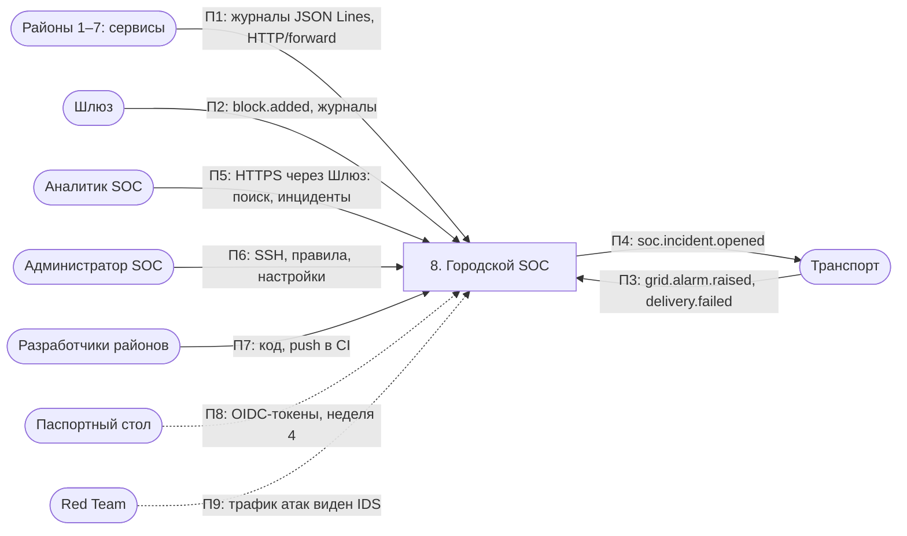
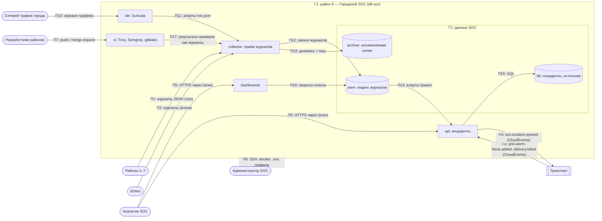

# Архитектура района 8 — Городской SOC

**Команда:** 8 · **Тимлид:** Пашкеев Данил · **Версия:** v0 · **Дата:** 19.10.2026

## 1. Назначение
Городской SOC — центр мониторинга безопасности города. Он принимает журналы (JSON Lines, Р4) от всех районов и тревоги от Шлюза, Энергосети и Транспорта, хранит их, ищет признаки атак, показывает дашборды и открывает инциденты (`city.soc.incident.opened.v1`). Также SOC отвечает за проверки безопасности в CI (Trivy, Semgrep, gitleaks) для репозиториев районов.

## 2. Политика безопасности
Записывать журналы в SOC могут только сервисы районов, и каждый — только от имени своего района (`district` в записи совпадает с отправителем); изменять или удалять принятые журналы не может никто, включая администратора SOC, — они только дописываются и хранятся не меньше срока игры. Читать журналы и инциденты может только аналитик SOC; менять правила обнаружения и настройки SIEM — только администратор SOC, и каждое такое изменение само записывается в журнал. Район, от которого нет журналов дольше 5 минут, считается «слепой зоной» и по нему открывается инцидент.

## 3. Компоненты
v0 — целевая схема. Сейчас в `compose.yaml` работает только заглушка `api` + `db` из шаблона; остальные сервисы добавляются с недели 3 (SIEM выбирается к неделе 3).

| Компонент (сервис Compose) | Что делает | Технология | Порт внутри района | Виден другим районам? |
|---|---|---|---|---|
| collector | приём журналов районов, проверка формата Р4 и отправителя, передача в SIEM | Fluent Bit / Vector | 24224 (forward), 8081 (HTTP) | да — только приём журналов |
| siem | индексация, поиск, правила корреляции, алерты | OpenSearch (или Wazuh indexer) | 9200 | нет |
| dashboards | дашборды и поиск для аналитиков | OpenSearch Dashboards | 5601 | нет (только аналитики SOC через Шлюз) |
| ids | анализ сетевого трафика города, алерты в collector | Suricata | — (сенсор) | нет |
| api | API инцидентов: создание, статус, источники; публикация событий в Транспорт | Python (заглушка из шаблона) | 8080 | да — через Шлюз |
| db | инциденты, статусы источников, учётные записи SOC | PostgreSQL 16 | 5432 | нет |
| archive | неизменяемая копия журналов (только дозапись, хеш-цепочка по дням) | том Docker / MinIO с object lock | — | нет |
| ci | проверки безопасности кода районов: Trivy, Semgrep, gitleaks | GitLab Runner / скрипт | — | нет |

## 4. Схема потоков данных (DFD)
Обозначения: `([...])` — внешняя сущность, `[...]` — процесс, `[(...)]` — хранилище, стрелка — поток (что и как), `subgraph` — зона доверия.

### Уровень 0

### Уровень 1

## 5. Границы доверия
| № | Граница | Что по разные стороны | Как контролируется сейчас | Как будет (неделя) |
|---|---|---|---|---|
| Г1 | город / район SOC | районы, Шлюз, Транспорт, жители, Red Team → collector, api | пока никак (порт только на 127.0.0.1) | TLS (3), mTLS для сервисов-отправителей (3–4), SSO для аналитиков (4), сегментация (6) |
| Г2 | сервисы SOC / данные | collector, api, dashboards → siem, db, archive | пароль базы в `.env`, порты данных не публикуются | отдельные учётки с минимальными правами, archive только на дозапись (7) |
| Г3 | район / шина событий | события любых районов ↔ api | пока никак | подпись событий, проверка `source`, защита от повтора по `id` (5) |
| Г4 | администратор / сервисы SOC | человек с SSH → всё | SSH-ключ; журнала действий администратора нет | журнал действий админа в archive, правило двух лиц на удаление (7) |
| Г5 | код районов / CI | присланный код и зависимости → CI-раннер с секретами | пока никак | изолированный раннер без секретов для чужого кода (7) |

## 6. Внешние зависимости
| От кого зависим | Что получаем | Что будет, если он недоступен или скомпрометирован |
|---|---|---|
| Все районы | журналы | недоступен — слепая зона; скомпрометирован — поддельные или удалённые записи |
| Шлюз | журналы, `block.added`, доступ аналитиков в SOC | теряем главный источник сетевых событий; аналитики не попадают в дашборды |
| Транспорт | доставка тревог и инцидентов | тревоги Энергосети не доходят; инциденты не доходят до районов |
| Паспортный стол | вход аналитиков (с нед. 4), сертификаты mTLS | вход только по локальным учёткам; поддельный сертификат = подделка отправителя |

## 7. Соответствие соглашениям города
- [x] Имена по Р1 (`d8-soc`, `*.soc.city.lab`)
- [x] Время UTC (Р3)
- [x] Журналы JSON Lines с обязательными полями (Р4) — SOC их и проверяет
- [x] События в конверте CloudEvents (Р5), описаны в `contracts/events.md`
- [x] API описан в `contracts/openapi.yaml`, есть `/health` (Р6)
- [x] Секретов в Git нет (Р7)
