# Практикум: TLS глазами наблюдателя (Wireshark)

**Студент:** Пашкеев Данил · **Команда:** 8, Городской SOC · **Дата:** 26.10.2026

## Часть 1. HTTP

**1. Логин и пароль.** В `POST /login` (пакет 4) в разделе «HTML Form URL Encoded» открытым текстом видны `login=ivanov` и `password=Gorod-2026`.

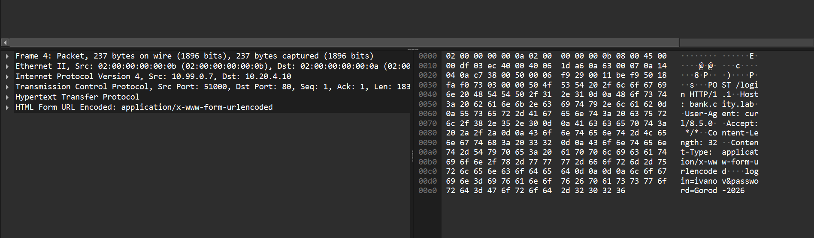

**2. Set-Cookie.** Сервер вернул `Set-Cookie: session=7f3a9c1e5b2d4f60; HttpOnly; Path=/`. Любой, кто увидел этот заголовок, может подставить cookie в свои запросы и работать в Банке как житель — пароль для этого не нужен (перехват сессии). `HttpOnly` защищает только от чтения из JavaScript, но не от подслушивания сети.

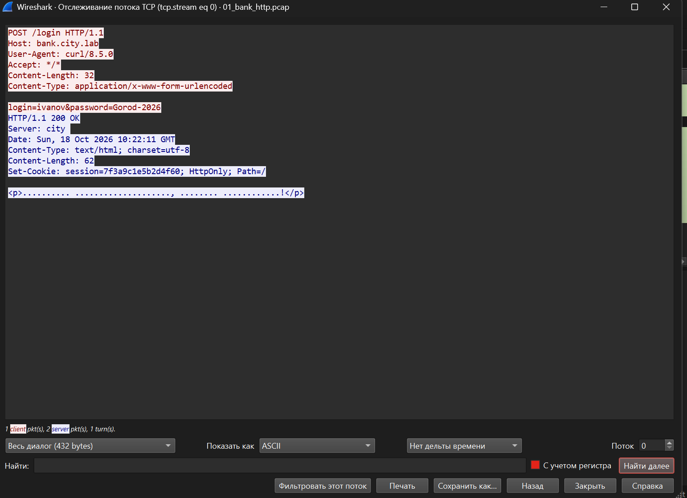

**3. Персональные данные в GET /account.** Открытым текстом прошли номер счёта `40817-0001`, ФИО владельца «Иван Иванов» и баланс `12 500,00 ₽`; в самом запросе — cookie сессии.

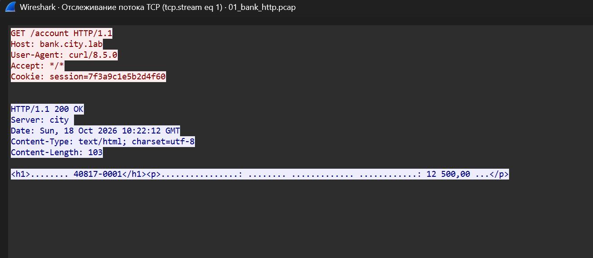

## Часть 2. HTTPS

**4. Что видно в открытую.** В ClientHello, в расширении `server_name` (SNI), видно имя сайта `bank.city.lab`. Наблюдатель также видит IP-адреса (10.99.0.7 → 10.20.4.10), порты (52000–52002 → 443), время и длительность соединений, их число, размеры зашифрованных записей, а также параметры клиента: поддерживаемые версии TLS, список шифров, ALPN `h2`.

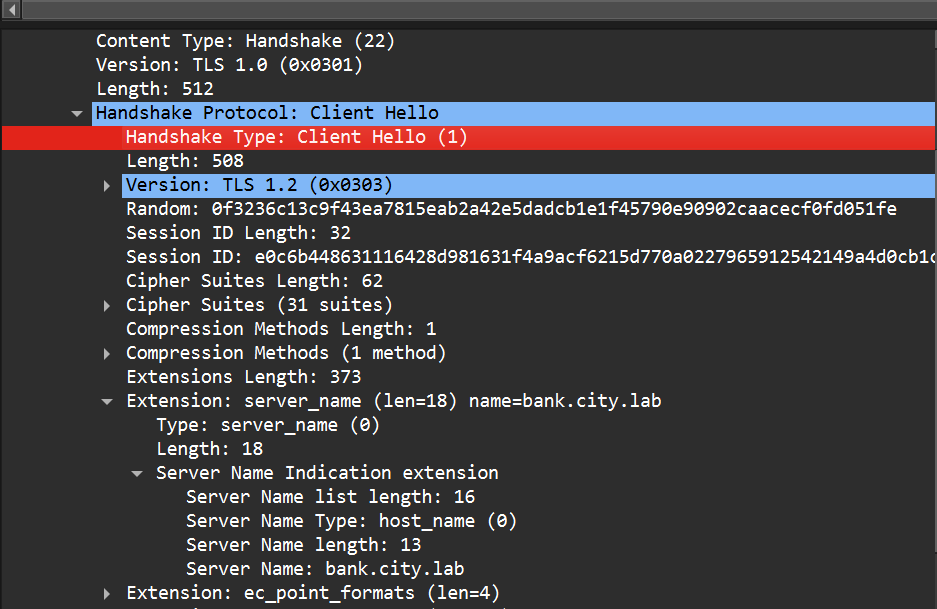

**5. Пароль или cookie.** Найти нельзя: фильтр `http` пуст, всё прикладное содержимое передаётся в записях `Application Data`, зашифрованных ключами сессии (AES-128-GCM). Ключи выводятся из обмена ECDHE, их на проводе нет.

**6. Сертификат в TLS 1.3.** В TLS 1.3 сертификат сервера идёт уже в зашифрованной части рукопожатия, поэтому наблюдатель не видит, какой именно сертификат и на какие имена (`api.bank.city.lab`, организация) предъявлен. В TLS 1.2 сертификат шёл открыто и раскрывал владельца и все имена сервера; остаётся только SNI.

## Часть 3. Клиент без корня города

**7. Alert.** `Level: Fatal (2)`, `Description: Unknown CA (48)`; отправил его **клиент** (10.99.0.7:52002), потому что не смог построить цепочку до доверенного корня, и соединение закрылось до отправки HTTP. С `curl -k` клиент принял бы любой сертификат, закончил рукопожатие и отправил бы логин и пароль — в том числе посреднику.

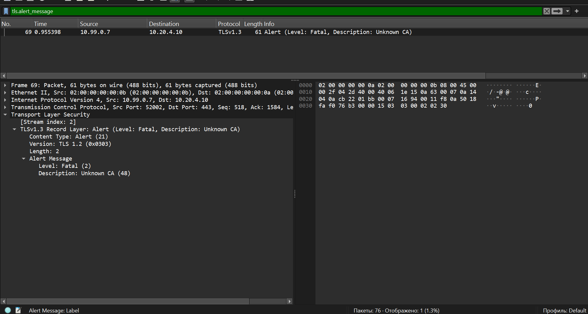

**8. Строчка для посредника.** Достаточно в коде **клиента** отключить проверку сертификата: `curl -k` / `--insecure`, `requests.get(..., verify=False)` в Python, `rejectUnauthorized: false` или `NODE_TLS_REJECT_UNAUTHORIZED=0` в Node.js, `proxy_ssl_verify off` в nginx. Тогда сертификат посредника принимается без вопросов, и он видит и меняет весь трафик.

## Часть 4. Расшифровка своими ключами

**9. Откуда ключи.** Wireshark взял их из файла `02_bank_https_keys.log`, который записал клиент (переменная `SSLKEYLOGFILE`): там секреты трафика каждой сессии (`CLIENT_TRAFFIC_SECRET_0`, `SERVER_TRAFFIC_SECRET_0` и др.), привязанные к случайному числу клиента. С этим файлом любой, у кого есть запись трафика, расшифрует сессию целиком — пароли, cookie, данные — без закрытого ключа сервера, поэтому файл такой же секрет, как пароль.

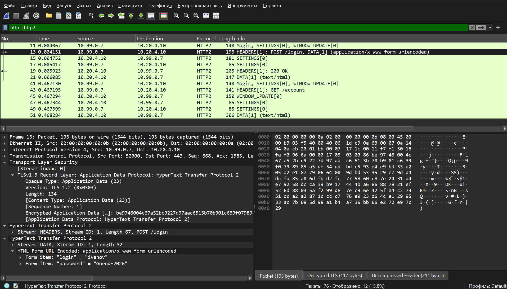

**10. Сертификат сервера.** Issuer — `CN=Digital City Issuing CA 1, O=Digital City` (выпускающий УЦ города, подписанный Digital City Root CA); SAN — `bank.city.lab`, `api.bank.city.lab`; действует с 18.10.2026 10:19:23 UTC до **16.01.2027 10:19:23 UTC** (90 дней).

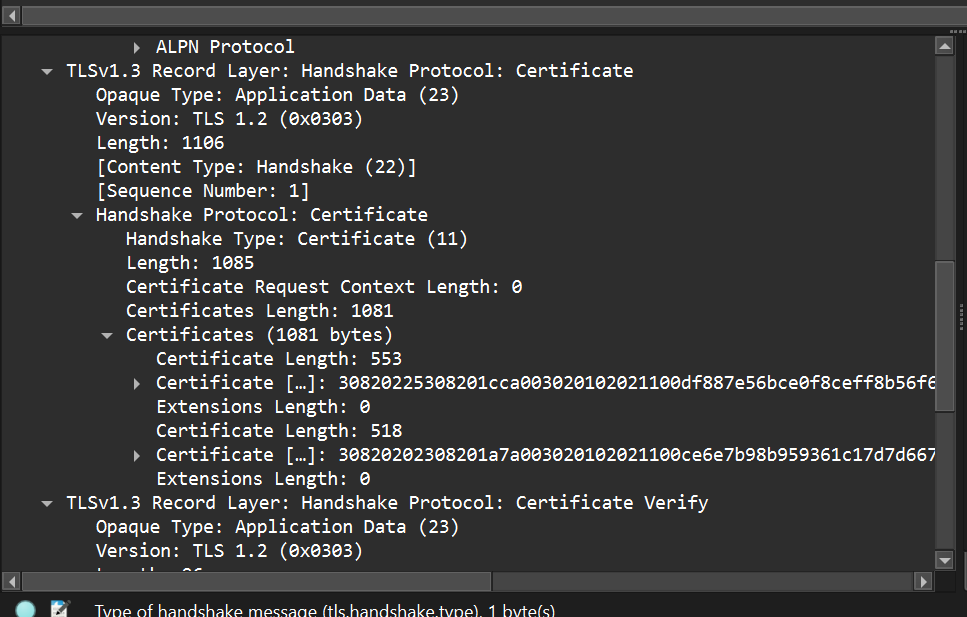

**11. Закрытый ключ сервера без файла ключей.** Нет. Ключи сессии получены обменом ECDHE (группа x25519) на одноразовых ключах, которые обе стороны выбросили после рукопожатия; ключ сервера только подписывает рукопожатие (ECDSA). Это прямая секретность: кража ключа сервера не раскрывает уже записанный трафик. (Третье соединение, 52002, не расшифровывается даже с файлом — для него в `keys.log` нет ключей.)

## Часть 5. Свой район (soc.city.lab)

`./scripts/check-tls.sh soc` — пройдено 7, ошибок 0 (полный вывод в [tls.md](tls.md)).

Запись: `sudo tcpdump -i lo -w ~/ws/my.pcap port 8443` (23 пакета) + `SSLKEYLOGFILE=$HOME/ws/my-keys.log curl -s --cacert tls/city-root.crt --resolve soc.city.lab:8443:127.0.0.1 https://soc.city.lab:8443/health` → `{"status": "ok"}`.

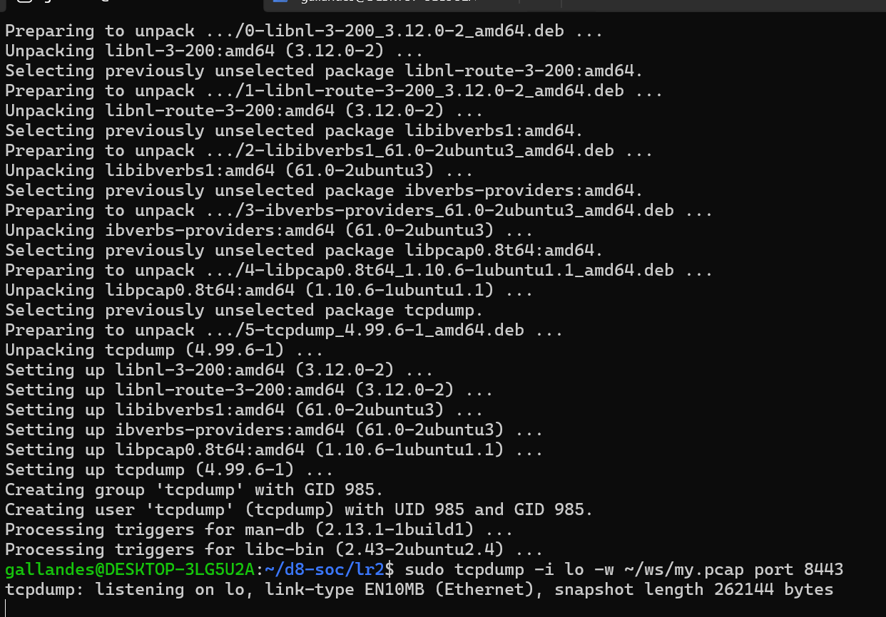

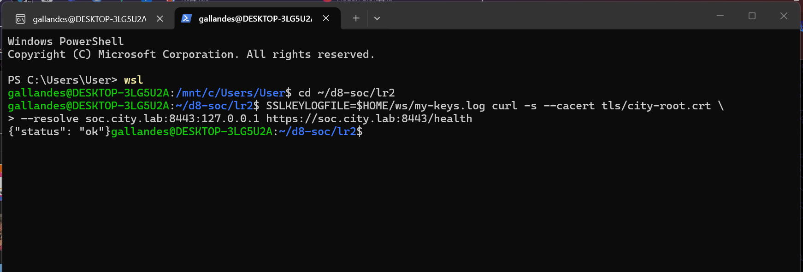

**12. Версия и шифр.** В своей записи `my.pcap` с ключами `my-keys.log` клиент (curl) и сервер (Caddy района SOC) согласовали **TLS 1.3** и шифр **TLS_AES_128_GCM_SHA256**, обмен ключами x25519 — совпадает с `check-tls.sh`. После расшифровки видны рукопожатие (Encrypted Extensions, Certificate `soc.city.lab`, Certificate Verify, Finished, New Session Ticket) и HTTP/2 `GET /health` с ответом `{"status": "ok"}`.

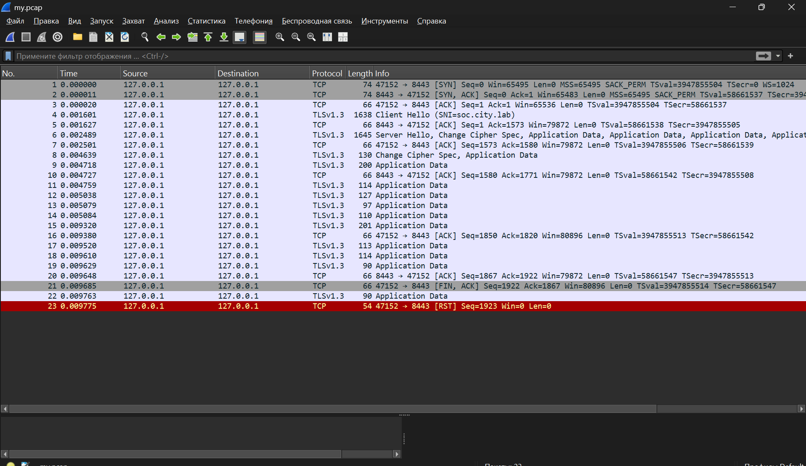

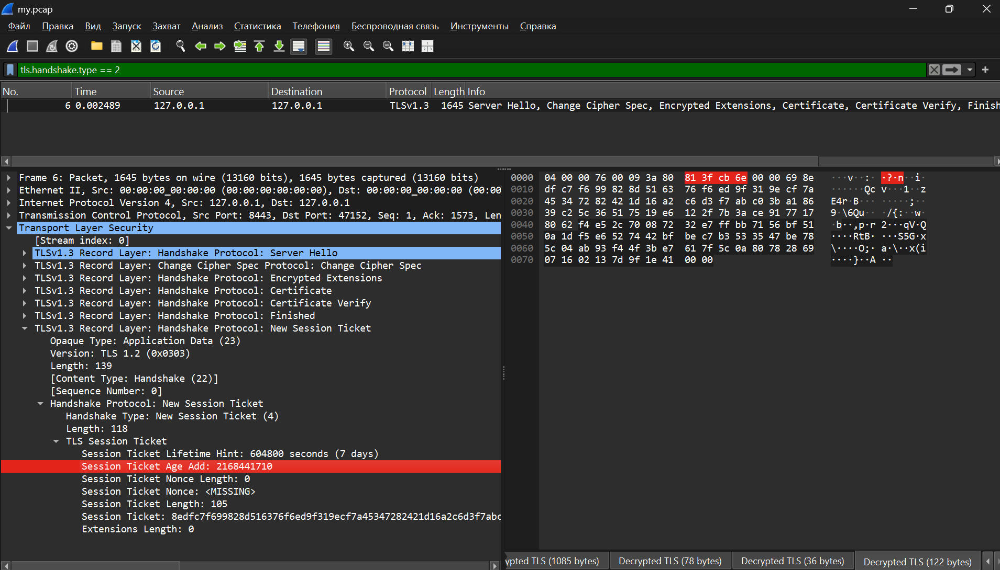

**Поломка 1 — из `tls/district.crt` убран сертификат выпускающего УЦ** (оставлен только сертификат района, `tls` перезапущен):
```text
curl: (60) SSL certificate OpenSSL verify result: unable to get local issuer certificate (20)
```
Клиент знает только корень и не может достроить цепочку `soc.city.lab → Issuing CA 1 → Root CA`. После проверки полный `district.crt` возвращён (2 сертификата, `git status` чистый).

**Поломка 2 — чужое имя `hospital.city.lab`:**
```text
$ curl -sS --cacert tls/city-root.crt --resolve hospital.city.lab:8443:127.0.0.1 https://hospital.city.lab:8443/
curl: (35) TLS connect error: error:0A000438:SSL routines::tlsv1 alert internal error
```
Отличие от ожидаемого: отказал **сервер** — в Caddy настроен только сайт `soc.city.lab`, для SNI `hospital.city.lab` сертификата нет, и он обрывает рукопожатие алертом `internal_error`, не предъявив сертификат. Чтобы увидеть проверку имени на стороне клиента, запросили сертификат `soc.city.lab`, а проверяли его на имя `hospital.city.lab` — так выглядит подсунутый чужой сертификат:
```text
$ openssl s_client -connect 127.0.0.1:8443 -servername soc.city.lab -verify_hostname hospital.city.lab -CAfile tls/city-root.crt
verify error:num=62:hostname mismatch
Verify return code: 62 (hostname mismatch)
```

**13. Какая ошибка — что.** «Unable to get local issuer certificate» — **ошибка настройки сервера**: сертификат настоящий, но сервер отдаёт неполную цепочку; исправляется на сервере (вернуть выпускающий УЦ в `district.crt`). «Hostname mismatch» — **признак возможного посредника**: на наше имя отвечает сервер с сертификатом на другое имя — так выглядит подмена DNS или перехват (реже — ошибка в адресе); такое соединение нужно обрывать, а не обходить через `-k`. Ответ сервера `internal_error` на чужое SNI — тоже настройка сервера: он просто не обслуживает это имя.

> Записи трафика и ключи сессий своего района (`my.pcap`, `my-keys.log`) в репозиторий не добавлены.

---

## Примечание о сдаче

Работа сдаётся не в полном объёме: из-за того, что задания по районам (ЛР2 «Городской УЦ и HTTPS» и Л2) временно не завершены, сейчас сдаётся только практикум Wireshark — отдельно от архива ЛР2. Часть 5 выполнена на работающем HTTPS района 8 (`soc.city.lab`, `check-tls.sh` — 7 из 7). ЛР2 и Л2 будут сданы позже, практикум войдёт в их архив (`lr2/docs/wireshark.md`).
